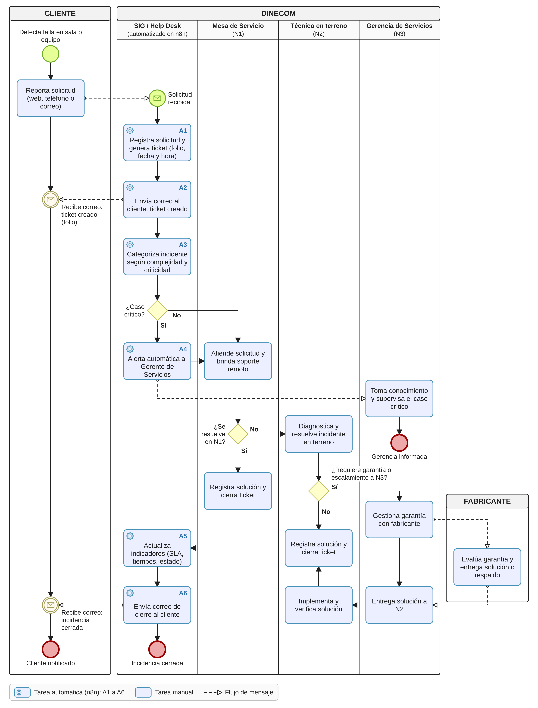

# 02 · BPMN to-be final (v2)

Proceso de gestión de incidencias de Dinecom Care con el SIG Help Desk. Parte del BPMN to-be de la Entrega 1 y le hace cuatro ajustes para poder automatizarlo con n8n.

*Figura 1. BPMN to-be final (v2), con tres participantes: Cliente, Dinecom (carriles SIG / Help Desk, Mesa de Servicio N1, Técnico en terreno N2 y Gerencia de Servicios N3) y Fabricante.*

## 1. Cómo funciona el proceso

- El cliente detecta una falla y la reporta por web, teléfono o correo. El SIG crea el ticket con folio, fecha y hora (A1), le avisa al cliente por correo (A2) y categoriza la falla según su complejidad y criticidad (A3).
- Si la falla es crítica, el SIG alerta al Gerente de Servicios (A4) y la Mesa de Servicio (N1) igual empieza a atender. Si N1 la resuelve, cierra el ticket. Si no, pasa al técnico en terreno (N2).
- Si N2 ve que hay que usar la garantía, el caso sube a N3: la Gerencia gestiona la garantía con el fabricante, recibe la solución y se la entrega a N2, que la instala, la verifica y cierra el ticket.
- Cuando el ticket se cierra en N1 o en N2, el SIG actualiza los indicadores (A5) y le manda el correo de cierre al cliente (A6). Así quedan guardados los tiempos para medir el SLA y el MTTR.

## 2. Cambios respecto a la Entrega 1

| Cambio | Antes (E1) | Ahora (E2) | Por qué |
| :--- | :--- | :--- | :--- |
| 1. Carril N3 separado | Un solo carril: «Gerencia / Fabricante». | Se separa la Gerencia de Servicios (N3) y el Fabricante queda como participante aparte. | Son actores distintos. |
| 2. Casos críticos | No estaban incluidos. | Compuerta «¿Caso crítico?» y alerta automática al Gerente (A4). | Cumplir el RF3. |
| 3. Aviso al crear el ticket | Solo se avisaba al cerrar el ticket. | Correo con el folio apenas se crea el ticket (A2). | Cumplir el RF8. |
| 4. Tareas automáticas | No se indicaba cuáles eran automáticas. | Se marcan A1 a A6 con engranaje y se ligan a n8n las implementadas (A1, A2 y A4). | Lo pide el enunciado de la Entrega 2. |

## 3. Tareas automáticas y su relación con n8n

| Tarea | Qué hace | Requisito | Estado en n8n |
| :-: | :--- | :-: | :--- |
| A1 | Registra la solicitud y genera el ticket (folio, fecha y hora). | RF1, RF2 | Implementada |
| A2 | Envía el correo al cliente: ticket creado. | RF8 | Implementada |
| A3 | Categoriza el incidente según complejidad y criticidad. | RF3 | Parcial: la prioridad llega en la solicitud |
| A4 | Alerta automática al Gerente de Servicios si el caso es crítico. | RF3 | Implementada |
| A5 | Actualiza los indicadores (SLA, tiempos, estado). | RF4, RF5 | No implementada |
| A6 | Envía el correo de cierre al cliente. | RF8 | No implementada |

La relación de cada tarea con los nodos del flujo está en [`05-automatizacion-n8n.md`](05-automatizacion-n8n.md).

## 4. Estados del ticket

Se usan los mismos estados de la Entrega 1. Los cierres en N1 y en N2 quedan como `Cerrado`.

| Momento del proceso | Estado que se registra |
| :--- | :--- |
| A1 crea el ticket | `Abierto` |
| N1 atiende la solicitud | `En proceso` |
| «¿Se resuelve en N1?» = No: pasa a N2 | `Escalado` (N2) |
| «¿Requiere garantía o escalamiento a N3?» = Sí: pasa a N3 | `Escalado` (N3) |
| Se cierra en N1 o N2 y actúa A5 | `Cerrado` |

## 5. Supuestos y limitaciones

- La criticidad se agregó al ticket; no estaba en la Entrega 1. El modelo de datos la incluye mediante `prioridad_sla` ([`03-modelo-datos.md`](03-modelo-datos.md)).
- Los correos del flujo son de prueba (cuenta de Ethereal); no se envían correos a clientes reales.
- No se modelan temporizadores de SLA ni el aviso de asignación. El SLA se calcula después, con las fechas de creación y cierre del ticket.
