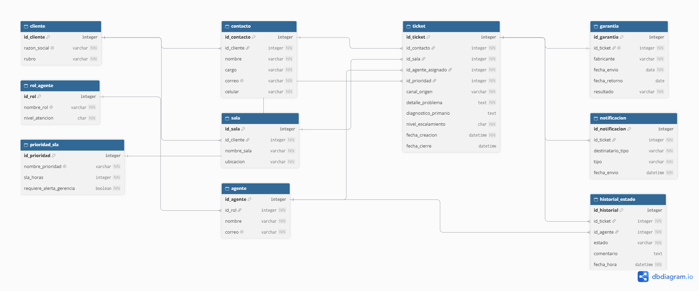

# 03 · Modelo de datos (ER en 3FN) y diccionario de datos

Proyecto SIG Dinecom Care (Entrega 2) — Base MySQL 8.0 (`dinecom_sig`)
ICN-292 Sistemas de Información para la Gestión · UTFSM Campus Vitacura · 2.º semestre 2026

Las 10 tablas, las claves PK/FK, las restricciones `CHECK` y la vista `v_ticket_estado_actual` corresponden a [`db/schema.sql`](../db/schema.sql) (MySQL 8.0).

## 1. Normalización a 3FN y resolución de anomalías respecto a E1

El modelo relacional de la base `dinecom_sig` (MySQL 8.0) fue normalizado a Tercera Forma Normal (3FN) mediante 10 tablas y 1 vista de apoyo (`v_ticket_estado_actual`), resolviendo las anomalías y vacíos detectados en la Entrega 1:

- **Eliminación de dependencia transitiva en `agente`:** en la Entrega 1, la entidad `agente` mezclaba `rol` y `nivel_atencion` (N1/N2/N3), generando riesgo de inconsistencia si cambiaban las reglas de asignación. Se separó la tabla catálogo `rol_agente` (`nombre_rol` → `nivel_atencion`), referenciada mediante la clave foránea `id_rol`.
- **Eliminación de duplicidad de estado (`estado_actual` vs. `historial_estado`):** se eliminó la columna redundante `estado_actual` de `ticket` para evitar desincronización con la bitácora. El estado vigente de cada incidente se obtiene de manera cronológica desde `historial_estado` a través de la vista `v_ticket_estado_actual`.
- **Incorporación de prioridad y acuerdos de nivel de servicio (`prioridad_sla`):** se creó la entidad `prioridad_sla` (`Critica` 4 h, `Alta` 8 h, `Media` 16 h, `Baja` 24 h) junto con el indicador `requiere_alerta_gerencia`, permitiendo disparar alertas críticas a gerencia (RF3) y auditar el cumplimiento de SLA.
- **Formalización completa de cardinalidades (incluyendo `notificacion`):** se explicitaron todas las relaciones del modelo, incorporando `notificacion` vinculada a `ticket` para auditar cada envío al cliente y las alertas críticas hacia gerencia.

## 2. Diagrama Entidad-Relación (3FN)

## 3. Cardinalidades de las relaciones

- **`cliente` (1) — (0..N) `contacto`:** una organización cliente puede tener múltiples contactos; cada contacto pertenece a un único cliente.
- **`cliente` (1) — (0..N) `sala`:** una organización cliente puede contar con múltiples salas audiovisuales; cada sala pertenece a un único cliente.
- **`contacto` (1) — (0..N) `ticket`:** un contacto puede reportar cero o múltiples incidentes; cada ticket tiene un contacto originador.
- **`sala` (1) — (0..N) `ticket`:** una sala puede registrar cero o múltiples incidentes; cada ticket ocurre en una sala específica.
- **`rol_agente` (1) — (0..N) `agente`:** cada rol define un único nivel de atención (N1, N2 o N3) y agrupa a los agentes de ese nivel.
- **`prioridad_sla` (1) — (0..N) `ticket`:** cada prioridad aplica a múltiples tickets y fija su plazo máximo de resolución en horas.
- **`agente` (1) — (0..N) `ticket` y (0..N) `historial_estado`:** un agente puede tener múltiples tickets asignados y registrar diversos cambios de estado.
- **`ticket` (1) — (1..N) `historial_estado`:** todo ticket nace con al menos su estado inicial (`Abierto`) y acumula su traza cronológica hasta `Cerrado`.
- **`ticket` (1) — (0..1) `garantia`:** un ticket puede derivar como máximo en una gestión de garantía o RMA con fabricante (`id_ticket` único en `garantia`).
- **`ticket` (1) — (0..N) `notificacion`:** un ticket puede generar cero o múltiples notificaciones hacia el cliente o alertas críticas hacia gerencia.

## 4. Diccionario de datos

### Tabla `cliente`

Empresas u organizaciones mandantes atendidas por Dinecom Care.

| Atributo | Tipo y restricciones (PK / FK / CHECK) | Descripción y regla de negocio |
| :--- | :--- | :--- |
| `id_cliente` | PK, INT AUTO_INCREMENT | Identificador único del cliente. |
| `razon_social` | VARCHAR(120), UNIQUE, NOT NULL | Nombre legal de la empresa cliente. |
| `rubro` | VARCHAR(80), NOT NULL | Sector económico de la organización. |

### Tabla `contacto`

Usuarios finales o contrapartes en terreno pertenecientes a un cliente.

| Atributo | Tipo y restricciones (PK / FK / CHECK) | Descripción y regla de negocio |
| :--- | :--- | :--- |
| `id_contacto` | PK, INT AUTO_INCREMENT | Identificador único del contacto. |
| `id_cliente` | FK → `cliente.id_cliente`, INT, NOT NULL | Empresa a la que pertenece el contacto. |
| `nombre` | VARCHAR(100), NOT NULL | Nombre completo del contacto. |
| `cargo` | VARCHAR(80), NOT NULL | Cargo dentro de la empresa cliente. |
| `correo` | VARCHAR(120), UNIQUE, NOT NULL | Correo electrónico de contacto. |
| `celular` | VARCHAR(25), NOT NULL | Teléfono o celular de contacto. |

### Tabla `sala`

Salas audiovisuales, directorios o espacios colaborativos asociados al cliente.

| Atributo | Tipo y restricciones (PK / FK / CHECK) | Descripción y regla de negocio |
| :--- | :--- | :--- |
| `id_sala` | PK, INT AUTO_INCREMENT | Identificador único de la sala. |
| `id_cliente` | FK → `cliente.id_cliente`, INT, NOT NULL | Empresa dueña o administradora de la sala. |
| `nombre_sala` | VARCHAR(100), NOT NULL | Nombre identificador de la sala. |
| `ubicacion` | VARCHAR(150), NOT NULL | Ubicación física de la sala. |

### Tabla `rol_agente`

Catálogo de roles operativos y su nivel de atención asociado en 3FN.

| Atributo | Tipo y restricciones (PK / FK / CHECK) | Descripción y regla de negocio |
| :--- | :--- | :--- |
| `id_rol` | PK, INT AUTO_INCREMENT | Identificador único del rol. |
| `nombre_rol` | VARCHAR(60), UNIQUE, NOT NULL | Nombre del rol interno. |
| `nivel_atencion` | CHAR(2), NOT NULL, CHECK (`'N1'`, `'N2'`, `'N3'`) | Nivel de soporte vinculado al rol. |

### Tabla `agente`

Integrantes internos de Dinecom que gestionan tickets o registran cambios de estado.

| Atributo | Tipo y restricciones (PK / FK / CHECK) | Descripción y regla de negocio |
| :--- | :--- | :--- |
| `id_agente` | PK, INT AUTO_INCREMENT | Identificador único del agente. |
| `id_rol` | FK → `rol_agente.id_rol`, INT, NOT NULL | Rol asignado al agente. |
| `nombre` | VARCHAR(100), NOT NULL | Nombre completo del agente. |
| `correo` | VARCHAR(120), UNIQUE, NOT NULL | Correo electrónico corporativo. |

### Tabla `prioridad_sla`

Catálogo de prioridades del incidente, tiempos máximos de resolución y alerta gerencial.

| Atributo | Tipo y restricciones (PK / FK / CHECK) | Descripción y regla de negocio |
| :--- | :--- | :--- |
| `id_prioridad` | PK, INT AUTO_INCREMENT | Identificador único de prioridad. |
| `nombre_prioridad` | VARCHAR(20), UNIQUE, NOT NULL | Etiqueta de prioridad (`Critica`, `Alta`, `Media`, `Baja`). |
| `sla_horas` | INT, NOT NULL, CHECK > 0 | Horas máximas comprometidas de resolución. |
| `requiere_alerta_gerencia` | BOOLEAN, NOT NULL | Indica si dispara alerta automática a gerencia. |

### Tabla `ticket`

Registro principal de cada incidencia reportada en Dinecom Care.

| Atributo | Tipo y restricciones (PK / FK / CHECK) | Descripción y regla de negocio |
| :--- | :--- | :--- |
| `id_ticket` | PK, INT AUTO_INCREMENT | Identificador único del ticket (opera como folio único). |
| `id_contacto` | FK → `contacto.id_contacto`, INT, NOT NULL | Contacto que reporta el caso. |
| `id_sala` | FK → `sala.id_sala`, INT, NOT NULL | Sala afectada por la incidencia. |
| `id_agente_asignado` | FK → `agente.id_agente`, INT, NOT NULL | Agente responsable asignado. |
| `id_prioridad` | FK → `prioridad_sla.id_prioridad`, INT, NOT NULL | Prioridad y SLA del ticket. |
| `canal_origen` | VARCHAR(20), NOT NULL, CHECK | Canal de ingreso (`'Telefono'`, `'Correo'`, `'Web'`). |
| `detalle_problema` | TEXT, NOT NULL | Descripción de la falla reportada. |
| `diagnostico_primario` | TEXT, NULL | Evaluación o diagnóstico inicial. |
| `nivel_escalamiento` | CHAR(2), NOT NULL, CHECK | Nivel actual de escalamiento (`'N1'`, `'N2'`, `'N3'`). |
| `fecha_creacion` | DATETIME, NOT NULL | Fecha y hora de creación del ticket. |
| `fecha_cierre` | DATETIME, NULL, CHECK >= `fecha_creacion` | Fecha y hora de cierre definitivo. |

### Tabla `historial_estado`

Bitácora cronológica de estados y fuente única de verdad del estado del ticket.

| Atributo | Tipo y restricciones (PK / FK / CHECK) | Descripción y regla de negocio |
| :--- | :--- | :--- |
| `id_historial` | PK, INT AUTO_INCREMENT | Identificador único del evento de historial. |
| `id_ticket` | FK → `ticket.id_ticket`, INT, NOT NULL | Ticket asociado (`ON DELETE CASCADE`). |
| `id_agente` | FK → `agente.id_agente`, INT, NOT NULL | Agente que registra el cambio. |
| `estado` | VARCHAR(20), NOT NULL, CHECK | Estado registrado (`'Abierto'`, `'En proceso'`, `'Escalado'`, `'Cerrado'`). |
| `comentario` | TEXT, NULL | Detalle o validación técnica del cambio de estado. |
| `fecha_hora` | DATETIME, NOT NULL | Momento exacto del registro. |

### Tabla `garantia`

Registro de gestión RMA o garantía con fabricante externo cuando aplica escalamiento.

| Atributo | Tipo y restricciones (PK / FK / CHECK) | Descripción y regla de negocio |
| :--- | :--- | :--- |
| `id_garantia` | PK, INT AUTO_INCREMENT | Identificador único del registro de garantía. |
| `id_ticket` | FK → `ticket.id_ticket`, INT, UNIQUE, NOT NULL | Ticket asociado (relación 1 a 0..1). |
| `fabricante` | VARCHAR(60), NOT NULL | Marca o fabricante del equipo gestionado. |
| `fecha_envio` | DATE, NOT NULL | Fecha de envío a garantía. |
| `fecha_retorno` | DATE, NULL, CHECK >= `fecha_envio` | Fecha de retorno del equipo. |
| `resultado` | VARCHAR(20), NOT NULL, CHECK | Estado RMA (`'En revision'`, `'Reemplazado'`, `'Reparado'`, `'Rechazado'`). |

### Tabla `notificacion`

Registro auditable de notificaciones enviadas a clientes y alertas críticas a gerencia.

| Atributo | Tipo y restricciones (PK / FK / CHECK) | Descripción y regla de negocio |
| :--- | :--- | :--- |
| `id_notificacion` | PK, INT AUTO_INCREMENT | Identificador único de la notificación. |
| `id_ticket` | FK → `ticket.id_ticket`, INT, NOT NULL | Ticket asociado (`ON DELETE CASCADE`). |
| `destinatario_tipo` | VARCHAR(20), NOT NULL, CHECK | Destinatario del aviso (`'Cliente'`, `'Gerencia'`). |
| `tipo` | VARCHAR(30), NOT NULL, CHECK | Tipo (`'Creacion'`, `'Cambio Estado'`, `'Alerta Critica'`, `'Cierre'`). |
| `fecha_envio` | DATETIME, NOT NULL | Fecha y hora de envío. |

### Vista de apoyo `v_ticket_estado_actual`

Consulta virtual derivada cronológicamente desde `historial_estado` (mediante la función ventana `ROW_NUMBER()` ordenada por `fecha_hora DESC, id_historial DESC`) que expone `estado_actual`, `fecha_ultimo_estado` y `ultimo_agente` por cada `id_ticket` sin violar 3FN.

## 5. Limitaciones del modelo

- Un ticket referencia un `contacto` y una `sala`, y ambos pertenecen a un `cliente`. El modelo no impide que un ticket combine un contacto de un cliente con una sala de otro cliente; el seed lo respeta, pero la base no lo garantiza.
- Los valores de catálogo (`Critica`, `En revision`, etc.) se guardan sin tildes para ser compatibles con las restricciones `CHECK`.
