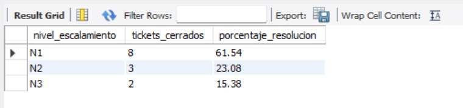
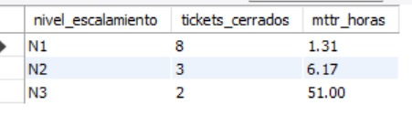
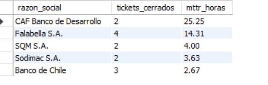
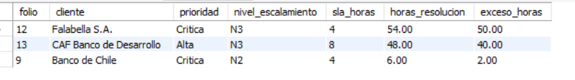
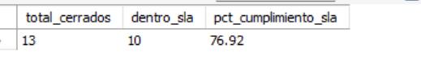
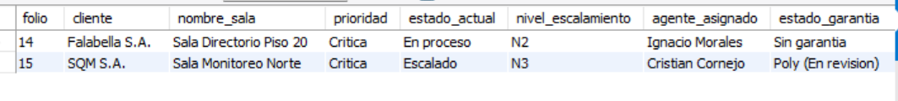

# 04 — Diseño SQL y consultas de negocio (`dinecom_sig`)

## 1. Implementación física (`db/schema.sql`)

- **Motor:** MySQL 8.0 (`utf8mb4_unicode_ci`). Se requiere 8.0.16 o superior para que se apliquen los `CHECK`.
- **Normalización (3FN):** 10 tablas (`cliente`, `contacto`, `sala`, `rol_agente`, `agente`, `prioridad_sla`, `ticket`, `historial_estado`, `garantia`, `notificacion`) y 1 vista (`v_ticket_estado_actual`).
- **Decisiones clave:**
  - Separación de `rol_agente` para eliminar la dependencia transitiva en `agente`.
  - Incorporación de `prioridad_sla` (`Critica` 4 h, `Alta` 8 h, `Media` 16 h, `Baja` 24 h) con indicador de alerta a gerencia (RF3).
  - Vista `v_ticket_estado_actual` (`ROW_NUMBER()`) como fuente única de verdad del estado, evitando duplicidad en `ticket`.

## 2. Carga de datos (`db/seed.sql`)

Los datos son sintéticos. El nombre del Gerente de Servicios corresponde a la persona del caso; su correo y el resto de los datos son ficticios.

- **Volumen cargado:** 5 clientes, 6 contactos, 7 salas, 3 roles, 5 agentes, 4 niveles de prioridad/SLA, 15 tickets (13 cerrados y 2 críticos activos), 37 eventos de historial, 3 garantías RMA (Cisco, Kramer, Poly) y 12 notificaciones (incluyen la alerta crítica a gerencia de cada uno de los 7 tickets críticos, según RF3).

## 3. Cómo reproducir los resultados

Con MySQL 8.0 y desde la raíz del repositorio (en Windows, usar CMD, Git Bash o MySQL Workbench; PowerShell no acepta el operador `<`):

```bash
mysql -u root -p < db/schema.sql
mysql -u root -p < db/seed.sql
mysql -u root -p < db/queries.sql
```

`schema.sql` borra y recrea la base `dinecom_sig`, por lo que puede ejecutarse más de una vez. Las capturas de este documento corresponden a la salida de `db/queries.sql`.

## 4. Resultados de las consultas (`db/queries.sql`)

### Consulta 1: Resolución por nivel vs. referencia de E1 (60 %–65 %)

| Nivel | Tickets cerrados | Resolución (%) |
| :--- | :---: | :---: |
| N1 (Remoto) | 8 | **61,54 %** |
| N2 (Terreno) | 3 | 23,08 % |
| N3 (Gerencia / Garantía) | 2 | 15,38 % |



**Interpretación:** el 61,54 % de los 13 tickets cerrados se resolvió en N1 (remoto), coherente con la referencia de E1 (60–65 %). Los datos son sintéticos: demuestran que el modelo permite medir el indicador, no son una medición real de Dinecom.

### Consulta 2: MTTR por nivel y por cliente

**2A — Por nivel:** N1: **1,31 h** | N2: **6,17 h** | N3 (garantía RMA): **51,00 h**



**2B — Por cliente:** CAF (25,25 h), Falabella (14,31 h), SQM (4,00 h), Sodimac (3,63 h), Banco de Chile (2,67 h).



**Interpretación:** un ticket que escala a N3 (garantía RMA) tarda en promedio 51 h, unas 39 veces más que uno resuelto en N1 (1,31 h). CAF y Falabella tienen el MTTR más alto porque los dos tickets N3 cerrados (folios 13 y 12) son de ellos; el tiempo depende del fabricante, no de la operación de Dinecom.

### Consulta 3: Cumplimiento de SLA

- **Cumplimiento global (3B):** **76,92 %** (10 de 13 tickets cerrados dentro de plazo).
- **Incumplimientos (3A):** folio 12 (Falabella, N3, +50,00 h), folio 13 (CAF, N3, +40,00 h) y folio 9 (Banco de Chile, N2, +2,00 h).





**Interpretación:** de los 3 incumplimientos, dos son escalamientos a garantía del fabricante (folios 12 y 13) y uno es un caso N2 por 2 h (folio 9). Ningún ticket resuelto en N1 incumplió el SLA, por lo que el punto crítico del servicio son los casos que dependen de garantía.

### Consulta 4: Incidentes críticos activos

| Folio | Cliente | Sala | Prioridad | Estado | Nivel | Agente | Garantía |
| :---: | :--- | :--- | :---: | :---: | :---: | :--- | :--- |
| 14 | Falabella S.A. | Sala Directorio Piso 20 | Critica | En proceso | N2 | Ignacio Morales | Sin garantia |
| 15 | SQM S.A. | Sala Monitoreo Norte | Critica | Escalado | N3 | Cristian Cornejo | Poly (En revision) |



**Interpretación:** hay 2 tickets críticos abiertos, ambos con SLA de 4 h: el folio 14 está en proceso en N2 y el folio 15 está escalado a N3 con garantía Poly en revisión. La consulta funciona como tablero para que gerencia priorice.

## 5. Limitaciones

- Los datos son sintéticos y 15 tickets no son una muestra estadística: los porcentajes y promedios ilustran el funcionamiento del modelo, no el desempeño real de Dinecom.
- El MTTR se mide desde la creación del ticket hasta su cierre, no hasta la primera respuesta.
- El modelo no impide que un ticket combine un contacto de un cliente con una sala de otro cliente; el seed lo respeta, pero la base no lo garantiza.
