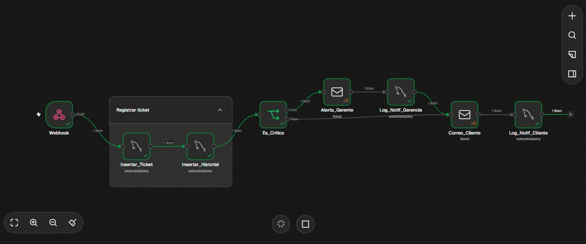
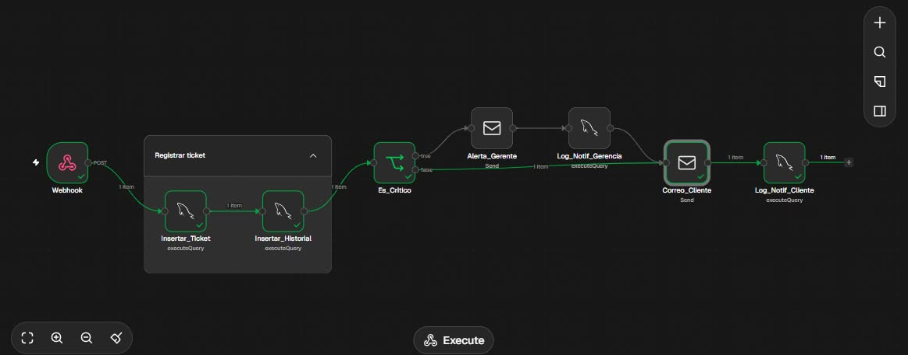
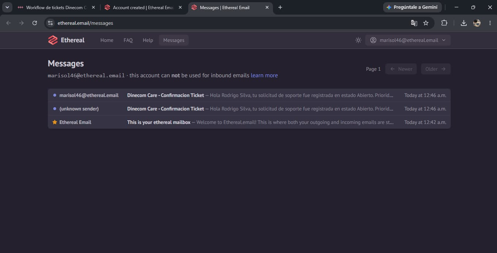
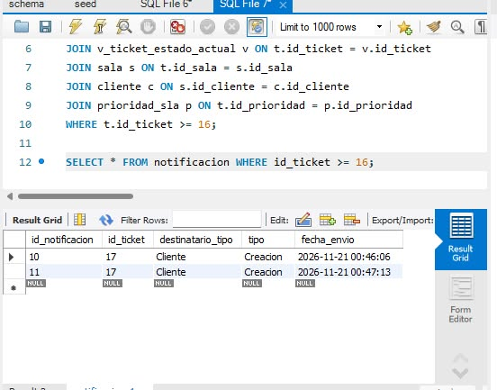

# 05 · Automatización con n8n — ingreso, escalamiento y notificación de tickets

Orquestación operativa en n8n integrada con la base de datos relacional `dinecom_sig` (MySQL 8.0). El flujo exportado está en [`n8n/Dinecom_Care_Nuevo_Ticket.json`](../n8n/Dinecom_Care_Nuevo_Ticket.json).

## 1. Propósito operativo y alcance de la automatización

Para reducir los tiempos de respuesta inicial en la mesa de servicio Dinecom Care y evitar omisiones en el registro de incidentes audiovisuales, se diseñó e implementó un flujo automatizado denominado `Dinecom_Care_Nuevo_Ticket` en la plataforma n8n. Este proceso conecta los canales de recepción de solicitudes con la base de datos `dinecom_sig` (MySQL 8.0, normalizada en 3FN) y con un servicio de mensajería de pruebas.

Cada vez que ingresa un reporte de falla de un cliente corporativo, el flujo ejecuta cuatro tareas de manera desatendida y trazable:

- **Recepción estandarizada de solicitudes:** captura los antecedentes del incidente mediante un punto de entrada HTTP (Webhook) en formato JSON, unificando los ingresos provenientes de teléfono, correo electrónico o portal web.
- **Registro transaccional y apertura de bitácora:** crea el nuevo ticket en la base de datos asignándole un folio correlativo automático y abre su historial cronológico en estado `Abierto`, respetando la integridad referencial del modelo.
- **Escalamiento inmediato para incidentes críticos (SLA 4 horas):** evalúa si la solicitud requiere alerta a gerencia y, en ese caso, despacha una alerta temprana al Gerente de Servicios.
- **Confirmación al cliente y auditoría de envíos:** envía un comprobante de recepción al contacto que reportó la falla y deja constancia de cada correo emitido en la tabla de auditoría `notificacion`.

## 2. Arquitectura y secuencia del workflow

El flujo está estructurado en ocho nodos encadenados que combinan operaciones de consulta SQL, evaluación condicional y despacho de correos electrónicos. Tras registrar el ticket y su estado inicial, el proceso bifurca su recorrido según la criticidad del incidente y vuelve a converger para que todo cliente reciba su comprobante de ingreso.

| # | Nodo | Tipo | Función en el proceso |
| :-: | :--- | :--- | :--- |
| 1 | `Webhook` | Trigger HTTP POST | Expone la ruta `/nuevo-ticket` y recibe el JSON del incidente. |
| 2 | `Insertar_Ticket` | MySQL (Execute Query) | Inserta el registro del caso en la tabla `ticket` con marca temporal `NOW()`; los dominios cerrados (canal y nivel) los valida el `CHECK` de la base. |
| 3 | `Insertar_Historial` | MySQL (Execute Query) | Registra el primer hito en `historial_estado` con estado `Abierto`, vinculado al folio recién generado. |
| 4 | `Es_Critico` | Condicional (IF) | Evalúa si el campo `requiere_alerta_gerencia` es igual a 1 para bifurcar el flujo. |
| 5 | `Alerta_Gerente` | Send Email (SMTP) | Rama verdadera: envía una notificación urgente al Gerente de Servicios por incidente con SLA de 4 horas. |
| 6 | `Log_Notif_Gerencia` | MySQL (Execute Query) | Rama verdadera: audita el aviso en `notificacion` (destinatario `Gerencia`, tipo `Alerta Critica`). |
| 7 | `Correo_Cliente` | Send Email (SMTP) | Punto de convergencia: envía el comprobante de creación del ticket al correo del contacto solicitante. |
| 8 | `Log_Notif_Cliente` | MySQL (Execute Query) | Audita la confirmación al usuario en `notificacion` (destinatario `Cliente`, tipo `Creacion`). |

### Trazabilidad con las tareas automáticas del BPMN to-be

Las tareas con engranaje del BPMN final (A1 a A6, ver [`02-bpmn.md`](02-bpmn.md)) se relacionan con el flujo así:

| Tarea BPMN | Qué hace | Nodos n8n | Estado |
| :-: | :--- | :--- | :--- |
| A1 | Recibe la solicitud y crea el ticket con folio, fecha y hora | `Webhook`, `Insertar_Ticket`, `Insertar_Historial` | Implementada |
| A2 | Envía al cliente el correo de ticket creado | `Correo_Cliente`, `Log_Notif_Cliente` | Implementada |
| A3 | Define el nivel de escalamiento y la criticidad | Ninguno: la prioridad y el nivel llegan en el JSON de entrada, y `Es_Critico` solo lee el campo `requiere_alerta_gerencia` | Parcial |
| A4 | Si el caso es crítico, alerta al Gerente | `Es_Critico`, `Alerta_Gerente`, `Log_Notif_Gerencia` | Implementada |
| A5 | Pasa el ticket a `Cerrado` y guarda fecha y tiempos | Ninguno | No implementada |
| A6 | Envía al cliente el correo de cierre | Ninguno | No implementada |

## 3. Integración transaccional y reglas de integridad

Para ser compatibles con las restricciones definidas en el esquema relacional, las consultas SQL de n8n respetan los dominios cerrados establecidos mediante cláusulas `CHECK` (sin acentos gráficos en los valores de catálogo) y vinculan cada registro secundario al último folio creado mediante la expresión `(SELECT MAX(id_ticket) FROM ticket)`.

**Creación del ticket (nodo `Insertar_Ticket`)**

```sql
INSERT INTO ticket (
  id_contacto, id_sala, id_agente_asignado, id_prioridad,
  canal_origen, detalle_problema, diagnostico_primario,
  nivel_escalamiento, fecha_creacion
) VALUES (
  {{ $json.body.id_contacto }},
  {{ $json.body.id_sala }},
  {{ $json.body.id_agente_asignado }},
  {{ $json.body.id_prioridad }},
  '{{ $json.body.canal_origen }}',
  '{{ $json.body.detalle_problema }}',
  '{{ $json.body.diagnostico_primario }}',
  '{{ $json.body.nivel_escalamiento }}',
  NOW()
);
```

**Bitácora inicial y auditoría de notificaciones**

```sql
-- 1. Apertura automática de estado en historial_estado (nodo Insertar_Historial)
INSERT INTO historial_estado (id_ticket, id_agente, estado, comentario, fecha_hora)
VALUES (
  (SELECT MAX(id_ticket) FROM ticket),
  {{ $('Webhook').item.json.body.id_agente_asignado }},
  'Abierto',
  'Ticket ingresado automaticamente via Webhook n8n',
  NOW()
);

-- 2. Registro de alerta crítica a gerencia (nodo Log_Notif_Gerencia)
INSERT INTO notificacion (id_ticket, destinatario_tipo, tipo, fecha_envio)
VALUES ((SELECT MAX(id_ticket) FROM ticket), 'Gerencia', 'Alerta Critica', NOW());

-- 3. Registro de confirmación al cliente (nodo Log_Notif_Cliente)
INSERT INTO notificacion (id_ticket, destinatario_tipo, tipo, fecha_envio)
VALUES ((SELECT MAX(id_ticket) FROM ticket), 'Cliente', 'Creacion', NOW());
```

### Configuración de conectividad e infraestructura

- **Acceso a MySQL 8.0:** se habilitó un usuario dedicado (`n8n_user`) con privilegios específicos sobre el esquema `dinecom_sig` y se estableció un túnel TCP (Pinggy hacia el puerto local 3306) para permitir la comunicación desde el entorno en la nube de n8n. El túnel es temporal y solo se usó para las pruebas.
- **Servicio de mensajería SMTP:** se configuró una cuenta de pruebas de Ethereal (`smtp.ethereal.email`, puerto 587, STARTTLS) para validar el envío de correos sin afectar casillas de clientes. Los mensajes quedan visibles en la bandeja de Ethereal, no se entregan a destinatarios reales.
- **Credenciales:** el archivo JSON exportado solo referencia las credenciales por nombre (`MySQL account`, `SMTP account`); no contiene contraseñas ni datos de conexión.

## 4. Validación funcional mediante casos de prueba

Con la base poblada con los 15 tickets de `db/seed.sql`, se enviaron peticiones HTTP POST al Webhook para ejercitar las dos ramas del flujo. Estas ejecuciones generaron los folios #16 y #17, que **no forman parte del seed**: en una base recién cargada con `schema.sql` y `seed.sql` existen solo los 15 tickets originales.

### Caso de prueba A: incidente crítico (rama hacia Gerencia)

Se simuló una falla total de videoconferencia en la Sala Directorio Piso 20 de Falabella S.A. (contacto Carolina Mendez, agente asignado Diego Rojas, prioridad `Critica` con SLA de 4 horas y `requiere_alerta_gerencia = 1`). El nodo `Es_Critico` derivó la ejecución por la rama verdadera, pasando por `Alerta_Gerente` y `Log_Notif_Gerencia` antes de converger en `Correo_Cliente` y `Log_Notif_Cliente`.

```json
{
  "id_contacto": 1,
  "nombre_contacto": "Carolina Mendez",
  "correo_contacto": "cmendez@cliente-falabella.cl",
  "id_sala": 1,
  "id_agente_asignado": 1,
  "id_prioridad": 1,
  "prioridad_nombre": "Critica",
  "requiere_alerta_gerencia": 1,
  "canal_origen": "Web",
  "detalle_problema": "Falla total de videoconferencia en Sala Directorio Piso 20",
  "diagnostico_primario": "Posible falla de hardware en matriz principal",
  "nivel_escalamiento": "N1"
}
```



### Caso de prueba B: incidente de prioridad media (flujo directo al cliente)

Se envió un segundo reporte por la desconfiguración de un micrófono inalámbrico en la Sala Reunión 14B (contacto Rodrigo Silva, agente asignado Camila Torres, prioridad `Media` con SLA de 16 horas y `requiere_alerta_gerencia = 0`). El nodo `Es_Critico` derivó la ejecución por la rama falsa directamente a `Correo_Cliente`, omitiendo la alerta ejecutiva y registrando la notificación de tipo `Creacion`.

```json
{
  "id_contacto": 2,
  "nombre_contacto": "Rodrigo Silva",
  "correo_contacto": "rsilva@cliente-falabella.cl",
  "id_sala": 2,
  "id_agente_asignado": 2,
  "id_prioridad": 3,
  "prioridad_nombre": "Media",
  "requiere_alerta_gerencia": 0,
  "canal_origen": "Correo",
  "detalle_problema": "Microfono inalambrico desconfigurado en Sala Reunion 14B",
  "diagnostico_primario": "Resincronizacion remota en N1",
  "nivel_escalamiento": "N1"
}
```



**Evidencia de la prueba B.** Los comprobantes recibidos en la bandeja de Ethereal y los registros de `notificacion` en MySQL Workbench:





## 5. Alcance real y limitaciones

- **Tareas automatizadas en este flujo:** registro del ticket y su estado `Abierto` (A1), correo de confirmación al cliente (A2) y alerta al Gerente (A4), con su auditoría en `notificacion`. La clasificación por criticidad (A3) no la calcula el flujo: la prioridad y el nivel llegan ya definidos en el JSON de entrada. El cierre del ticket (A5) y el correo de cierre (A6) del BPMN no están implementados en este flujo.
- **Correos de prueba:** todos los envíos usan una cuenta de Ethereal; no se enviaron correos a clientes ni a gerencia reales.
- **Folio en la alerta:** el asunto y el texto del correo `Alerta_Gerente` no incluyen el número de folio, porque la plantilla no lo inserta.
- **Construcción de las consultas:** los valores del JSON se insertan directamente en el texto SQL. Una comilla simple en `detalle_problema` rompe la consulta, y el flujo no valida los datos de entrada.
- **Vinculación por `MAX(id_ticket)`:** el historial y las notificaciones se asocian al último ticket de la tabla. Con dos solicitudes simultáneas podrían asociarse al ticket equivocado.
- **Coherencia de datos:** el flujo no comprueba que el contacto y la sala del JSON pertenezcan al mismo cliente.
